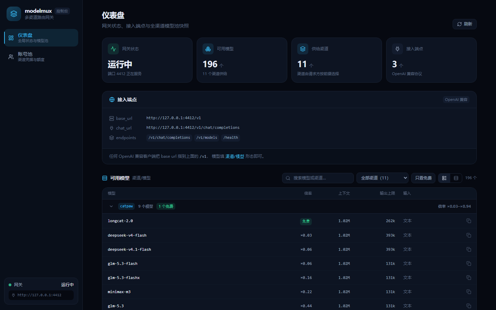
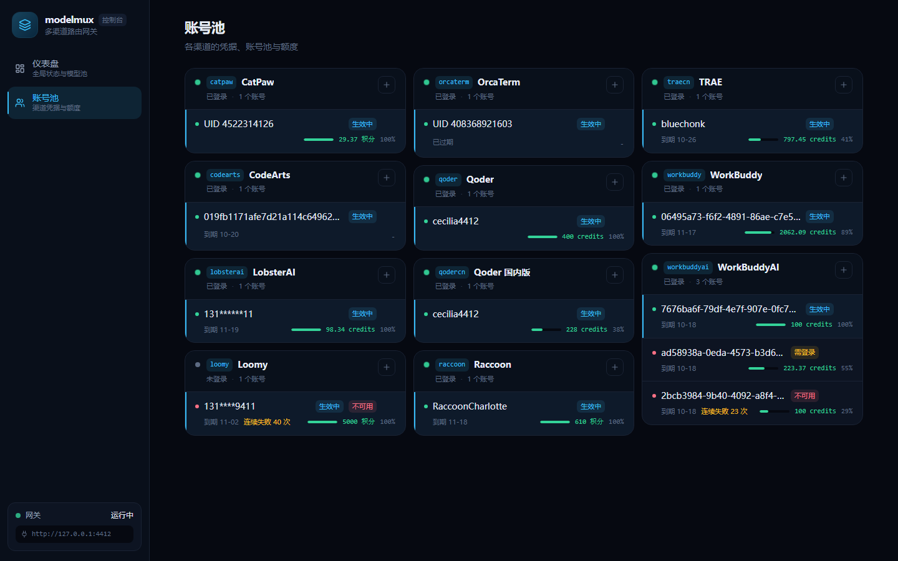

# modelmux

本地多渠道路由网关 CLI：把多个渠道汇成**一个 OpenAI 兼容端点**，对外暴露各渠道目录里的
真实模型（`<渠道>/<模型>` 池 id，渠道由请求方指定）。专注做一件事：`npx modelmux` 起网关，
任何 OpenAI 兼容客户端指过来就能用。

## 这是什么

- **一个网关**：监听 `127.0.0.1:4412`，提供 `/v1/chat/completions`、`/v1/models`、`/health`。
- **动态模型池**：对外模型 id 为 `<cid>/<模型>`（如 `loomy/kimi-k2.6`），`/v1/models` 实时汇总
  全部渠道 `catalog` 的归一化结果。客户端用渠道前缀显式选渠道；同名模型在不同渠道是独立 id。
- **11 个渠道**：每个渠道是一个池子（模型目录 + 凭据 + 上游协议），注册在 `packages/core/channels/` 下。
- **自动化兜底**：签到、账单 / 目录刷新、账号健康度与连败跳过、上游空闲超时，全部由网关自动完成。

## 目录

```
packages/
├── cli/                      CLI 入口（bin modelmux / mx，注册全部渠道后交给共享 CLI）
├── ui/                       Web 管理看板（React 19 SPA，`mx web` 托管）
└── core/                     服务端运行时
    ├── gateway/              共享层（网关 / 守护 / 路径 / 渠道注册表）
    └── channels/<cid>/       一个渠道 = 一个池子（模型目录 + 凭据 + 上游协议）
docs/                         全部文档（契约与规范 + 渠道文档 docs/channels/<cid>/）
```

## 快速开始

```bash
npm install          # 装工作区依赖
npm run build        # 全仓编译（tsc -b + cli 单文件 bundle + copy-ui）
npm test             # build + 全部校验器 + 全部包的测试

node packages/cli/dist/cli.js start              # 启动网关（守护式，端口 4412）
node packages/cli/dist/cli.js status --json      # reachable / stale_build / 日志目录
node packages/cli/dist/cli.js model list         # 池视图：有哪些模型（按渠道分组）
node packages/cli/dist/cli.js model usage        # 池账本：各渠道用得怎么样（每渠道一行）
node packages/cli/dist/cli.js login <cid>        # 登录某个渠道（浏览器授权）
node packages/cli/dist/cli.js web                # 打开 Web 控制台（http://127.0.0.1:4412/web/）
node packages/cli/dist/cli.js log --list         # 分层日志：access / error / system
```

### 全局安装 / npx

`packages/cli` 构建后是自包含的单文件 bundle（`dist/cli.bundle.js`，内联 gateway
与全部渠道），可脱离本仓库安装；发布到 npm 后支持 `npx modelmux`：

```bash
npm i -g modelmux    # 或：cd packages/cli && npm pack && npm i -g ./modelmux-*.tgz
mx start                     # 任意目录直接可用（全名 modelmux 等价）
mx model list
```

注意：bundle 形态下陈旧构建检测（`status` 的 stale_build）找不到工作区根，会退化为
不报告——这是已知限制，不影响网关功能。

## 接入任意客户端

网关不绑定任何宿主工具：任何 OpenAI 兼容客户端（CLI、IDE、桌面应用）把 base url
指到 `http://127.0.0.1:4412/v1`，模型填 `<渠道>/<模型>` 形态的池 id
（清单看 `GET /v1/models`，如 `loomy/kimi-k2.6`；API key 任意非空）即可。

## Web 控制台

`mx web` 起一个本地看板（`http://127.0.0.1:4412/web/`）：网关状态、接入端点、
全渠道模型池与各渠道账号池额度，都在同一页里。





- **仪表盘**：网关状态 / 可用模型 / 供给渠道 / 接入端点四块统计 + 接入端点面板 +
  模型区（按渠道分组的表，列出每个模型的**倍率、上下文窗口、输出上限与输入模态**，
  可按渠道筛选、只看免费、切「分组 / 扁平」两种视图）。
- **账号池**：每个渠道的登录状态、账号列表、剩余额度与到期时间、切换 / 删除 / 新增。

页面结构、数据通道与设计令牌见 [docs/WEB-CONSOLE.md](docs/WEB-CONSOLE.md)。

## 文档

项目规则在 [AGENTS.md](AGENTS.md)；契约与规范在 `docs/`（入口 [docs/README.md](docs/README.md)），**渠道文档统一在** `docs/channels/<cid>/`：

| 想看什么 | 去哪 |
| --- | --- |
| 项目规则（开发 / 提交 / 测试） | [AGENTS.md](AGENTS.md) |
| 契约与规范 | [docs/CONTRACT-TS.md](docs/CONTRACT-TS.md) |
| 公共模型池与账号池 | [docs/POOL-ARCHITECTURE.md](docs/POOL-ARCHITECTURE.md) |
| 存储落点规范 | [docs/STORAGE-CONVENTION.md](docs/STORAGE-CONVENTION.md) |
| 运行日志与排查 | [docs/LOGGING.md](docs/LOGGING.md) · 技能 `.agents/skills/log-triage/SKILL.md` |
| `mx` 命令用法 | 技能 `.agents/skills/mx-cli/SKILL.md` |
| 某个渠道怎么用 | [docs/channels/README.md](docs/channels/README.md)（通用用法）· `docs/channels/<cid>/PROTOCOL.md`（该渠道的差异） |
| 某个上游的协议细节 | `docs/channels/<cid>/PROTOCOL.md` |
